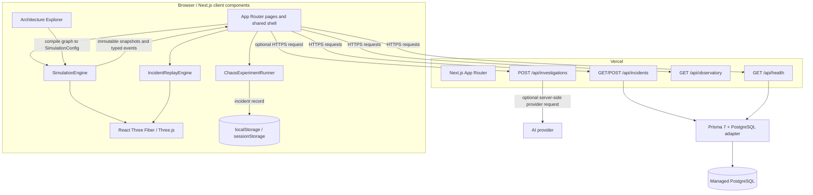

# FAULTLINE technical architecture

This document describes the implementation in the repository. It separates the browser simulation from request-scoped server operations and records the current limitations that affect deployment.

## System boundary

The App Router composes the interface. Interactive state lives in browser-side TypeScript. Vercel Functions handle bounded requests and optional persistence; they do not host the simulation loop, retain authoritative state between requests, or provide WebSockets.

## Repository boundaries

| Path                       | Responsibility                                                                                        |
| -------------------------- | ----------------------------------------------------------------------------------------------------- |
| `app/(platform)/`          | Public page routes and shared platform layout                                                         |
| `app/api/`                 | Node.js and web-standard Route Handlers                                                               |
| `components/`              | Route UI, navigation shell, canvas surfaces, inspectors, analytics and editors                        |
| `simulation/`              | Clock, scheduler, seeded RNG, graph, services, routing, metrics and chaos lifecycle                   |
| `services/`                | Browser incident/architecture stores, replay, analytics, report generation and AI evidence validation |
| `database/`                | Prisma client creation using the server environment                                                   |
| `prisma/`                  | PostgreSQL schema and ordered migrations                                                              |
| `types/`                   | Contracts shared between engine, UI, and APIs                                                         |
| `animations/` and `hooks/` | Reusable motion tokens, GSAP scoping and simulation subscriptions                                     |
| `e2e/`                     | Production-build Playwright workflows, axe audits and responsive smoke checks                         |

## Rendering and runtime model

### App Router and SSR

- `app/layout.tsx` loads the local Space Grotesk and Inter variable fonts and global tokens.
- `app/(platform)/layout.tsx` wraps routes with `SiteShell` while preserving the requested public URL.
- Pages are server components unless an interactive client component is imported. The shell and interactive product surfaces use client components for navigation state, animations, subscriptions, and browser storage.
- React Three Fiber scenes are dynamically imported with `ssr: false` from client components. This keeps WebGL/browser APIs out of server rendering.
- Route-level `loading.tsx`, `error.tsx`, and root `global-error.tsx` provide load and failure UI.

### Vercel compatibility

- The project uses the supported Next.js framework integration and Node.js Route Handlers. It has no custom server entry point, background worker process, runtime file persistence, edge-only PostgreSQL dependency, or socket server.
- `app/api/health`, `app/api/incidents`, and `app/api/investigations` use the Node.js runtime. `/api/observatory` is a short, read-only handler.
- The engine only advances while the browser simulation is active. Experiment completion, replay, and graphics are not delegated to a Function.
- PostgreSQL is an optional managed service. Runtime connections use `DATABASE_URL`; migration configuration prefers `DIRECT_URL`.
- The app can be deployed in guest/demo mode with neither database nor AI credentials. In that mode, history is local to the browser.

Vercel detects Next.js and normally supplies the build and output integration. There is no required `vercel.json` override. Deployment setup and release gates are documented in [README.md](README.md#github-and-vercel-deployment).

## Simulation model

`SimulationEngine` has no React or Three.js dependency. Its important collaborators are:

1. **`SimulationClock`** advances virtual time deterministically.
2. **`SimulationScheduler`** orders service and recovery work due at each virtual timestamp.
3. **`SeededRandom`** owns repeatable request, route, latency, and failure choices.
4. **`TrafficGenerator`** converts rate and fractional carry into weighted scenario requests.
5. **`DependencyGraph`** validates directed service dependencies and expands required routes.
6. **`RequestRouter`** propagates requests through services, applies failure and recovery policies, and produces request outcomes and paths.
7. **`ServiceRegistry` / `ServiceNode`** own health, capacity, queue pressure, runtime overrides, and resource state.
8. **`MetricsCollector` / `MetricsAggregator`** derive rolling request, latency, error, throughput, utilization, and connection metrics.

The default example model is declared in `simulation/observatory-scenario.ts`: ten example services with caller-to-dependency edges, weighted routes, fixed capacities, a seed, and a virtual tick. These are simulation inputs, not production measurements.

### Clock and subscriptions

Tests and deterministic replays use `advanceBy()` or `runTicks()` and do not wait on wall time. Interactive pages use `start()` / `pause()` as a small interval adapter over the same clock. React subscribes with `useSyncExternalStore` to immutable state snapshots. Typed event listeners provide causal details without making React the model owner.

### Chaos experiment lifecycle

`ChaosExperimentRunner` stages a validated `ChaosExperimentConfig`, performs a health precheck, waits for explicit user confirmation, injects a fault profile, records relevant simulation events and periodic replay frames, withdraws the fault, and verifies recovery before producing a result and incident record. Recovery strategies are modeled in the same routing/engine boundary, including retry/backoff, circuit breaking, fallback reads, traffic redistribution, restart, and capacity scaling.

The runner's status is browser-session state; the resulting incident is saved only after the completion workflow has enough evidence. Request/recovery events remain in the recorded incident even when repeated log lines are deduplicated in the live feed.

### Historical replay

`IncidentReplayEngine` takes one complete `IncidentRecord` and owns a separate replay cursor. For any cursor time it:

1. Selects the latest replay frame not later than the cursor.
2. Clones the frame so replay operations cannot mutate stored incident data.
3. Applies later typed events in sequence order.
4. Publishes reconstructed state for the timeline, service inspector, metrics, and 3D graph.

Replay supports play/pause, restart, event stepping, seeking, and bounded playback speeds. It is historical reconstruction, not a second live simulation.

## 3D rendering

`ObservatoryNetwork` and the landing canvas render on the browser with Three.js through React Three Fiber and Drei. Service nodes, edges, packet markers, camera controls, and focus state are reusable scene components. Heavy scenes are client-loaded; counts adapt for device capability; shared geometry is scoped to the mounted scene and released at teardown. Reduced-motion preferences affect the visual choreography.

The scene displays the simulation or replay snapshot passed to it. It does not independently invent service health or metrics. WebGL availability, software-rendering behavior, and mobile frame rate still require verification on deployment-target devices.

## Architecture Explorer

The editor stores `ArchitectureDocument` nodes and directed caller-to-dependency edges. The graph layer checks endpoint validity, self-dependencies, constraints, and cycle risks. Templates are immutable source configurations; editor operations create updated documents. The adapter maps supported component types and edges into the same `SimulationConfig` contract used by the observatory engine.

Saved documents use browser local/session storage, not server storage. A public API or cross-user architecture collaboration layer does not currently exist.

## Persistence and data model

The browser `IncidentRecord` is the shared domain record. It carries a stable ID, configuration, affected services, measured results, typed events, replay frames, and sampled request latency. Local guest storage keeps a bounded subset. With a database configured, the incident Route Handler validates the same contract and maps fields to the Prisma `Incident` model.

### PostgreSQL models

- **`Incident`** — IDs, timestamps, severity, affected services, root cause, configuration/actions/metrics JSON, simulation boundaries, events/replay snapshots JSON, and latency sample JSON. Indexes support descending timestamp and severity/timestamp listing.
- **`ChaosExperiment`** — schema for a persisted experiment definition. The current browser Chaos Lab does not use this table as a run queue or execution store.

JSON is used for versioned domain structures whose full event/snapshot shape is needed for replay. Scalar timestamps/severity are kept as columns for indexing and selection.

### Migrations

Migrations are committed under `prisma/migrations/`. `prisma.config.ts` selects `DIRECT_URL` first and falls back to `DATABASE_URL`. `npm run db:migrate` runs `prisma migrate deploy`; execute it from a trusted deployment step after checking the target environment. Do not add migration execution to a user-facing request or an always-on server.

## API behavior and trust boundaries

| Endpoint                   | Runtime and responsibility                                                                                            | Failure behavior                                                                                                   |
| -------------------------- | --------------------------------------------------------------------------------------------------------------------- | ------------------------------------------------------------------------------------------------------------------ |
| `GET /api/health`          | Node.js; returns demo status without a DB URL or performs a `SELECT 1` check when configured.                         | Returns `503` and degraded/demo status if a configured database cannot be reached.                                 |
| `GET /api/observatory`     | Read-only example data; no persistence.                                                                               | No external provider dependency.                                                                                   |
| `GET /api/incidents`       | Node.js; recent incident summaries or a detail lookup by `id`.                                                        | No URL configured: empty demo result. Configured but unavailable DB: `503`; browser store remains available.       |
| `POST /api/incidents`      | Node.js; bounded JSON, content-type, origin and incident validation before a DB create. Duplicate IDs are idempotent. | No database: `503` after client-side guest record save. Invalid and oversize requests are rejected.                |
| `POST /api/investigations` | Node.js; bounded incident evidence, structured provider request, output/evidence validation.                          | Missing key/provider failure/invalid output: explicit unavailable status and deterministic local evidence summary. |

The `OPENAI_API_KEY` is read only in the server Route Handler. It is not returned to the client. The provider request has a timeout, an output bound, and uses `store: false`. The fallback does not invent AI analysis, recommendations, or successful provider status.

Same-origin validation and size limits are defensive input controls, not account security. The current incident write endpoint has no user authentication or distributed rate limiting. Do not expose database-backed writes or billable AI usage to untrusted public traffic until deployment protection or app authentication and appropriate request limits are in place.

## Error and graceful-degradation paths

- No `DATABASE_URL`: observability and simulation continue; incidents/architecture use browser storage.
- Browser storage blocked: session storage is tried; an in-memory fallback is retained for the active page where supported by the flow.
- Database connection error: API reports degraded/unavailable rather than claiming persistence; local incident history remains.
- Missing AI key or provider failure: the investigator labels AI unavailable and returns a deterministic local evidence summary.
- Reduced-motion preference: cinematic and continuous CSS motion is curtailed.
- Route rendering failure: route and root error boundaries provide recovery UI; route loading boundaries display during navigation.

## Security and operational assumptions

- Environment secrets are server-only. Do not add `NEXT_PUBLIC_` prefixes to server credentials.
- React renders user-authored labels and descriptions as text; they are not inserted as raw HTML.
- API payload sizes and incident shape are bounded and validated before database mapping.
- This is currently a single-user/guest experience. There is no tenant isolation, user/role model, ownership, audit authorization, or abuse quota.
- The example services are not connected to real infrastructure. Never connect this simulation to production targets or represent its values as operational telemetry.
- Use Vercel Preview deployments and a separate non-production database for release verification. Keep the public demo database-free or put database and AI routes behind access control until the missing identity/abuse boundaries are implemented.

## Verification strategy

- Vitest validates deterministic runs, routing, dependency propagation, failure/recovery states, metrics, incident persistence shapes, replay reconstruction, architecture validation, analytics calculations, report content, and API boundaries.
- Integration-style tests cover persistence fallbacks, architecture and report/analytics data flow without claiming a live managed database.
- Playwright runs a production Next.js build, exercises the user workflows, checks the 3D canvas, audits the main routes with axe, and records local responsive/load smoke checks.
- A successful local build/test is not proof of Vercel configuration, external provider access, production database connection, or deployed behavior.

## Production deployment gates

Before a public production release with persistent storage or AI enabled:

1. Add and verify the Vercel Git integration, Preview/Production environment scopes, and a verified deployment URL.
2. Create the managed PostgreSQL database; confirm its pooled runtime and migration connections and deploy migrations from a trusted job.
3. Add user authentication/authorization or protect the deployment and write endpoints with an external access boundary; add distributed rate limits.
4. If enabling AI, verify the server secret is environment-scoped and add a budget/abuse limit appropriate to the deployment.
5. Run route, browser, database, and 3D checks against the actual Preview deployment, then verify after Production promotion.
6. Add device-level WebGL, memory, and field Core Web Vitals checks before claiming production performance characteristics.
