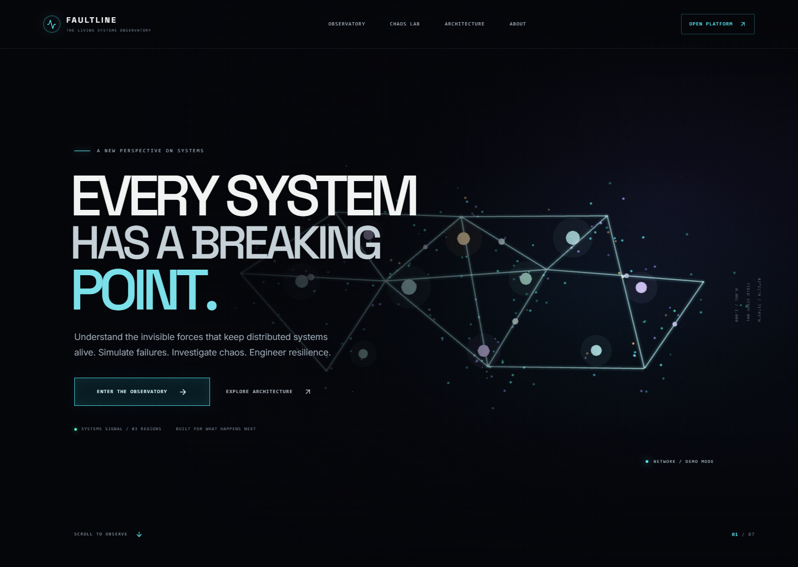
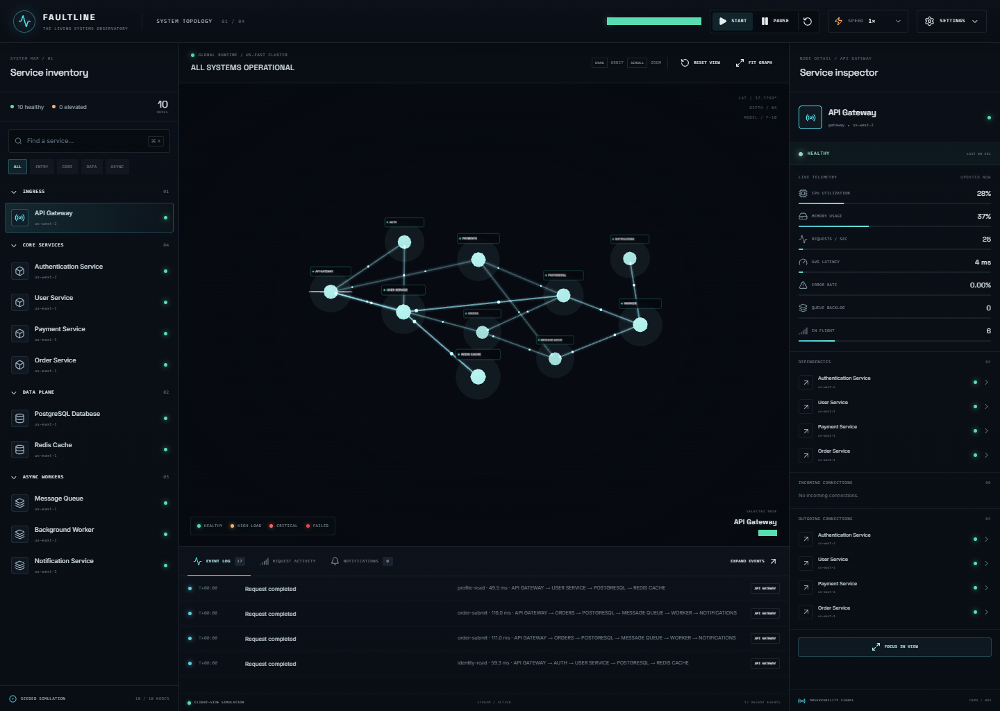
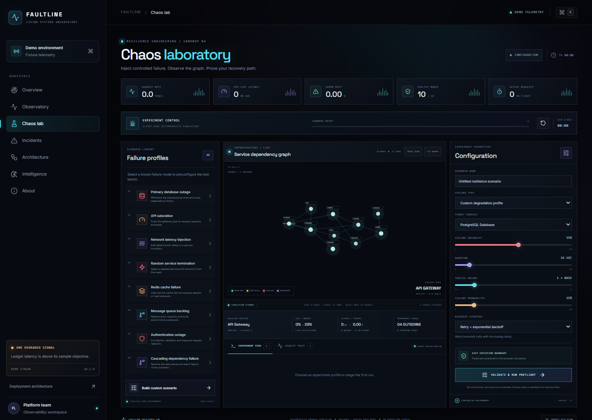
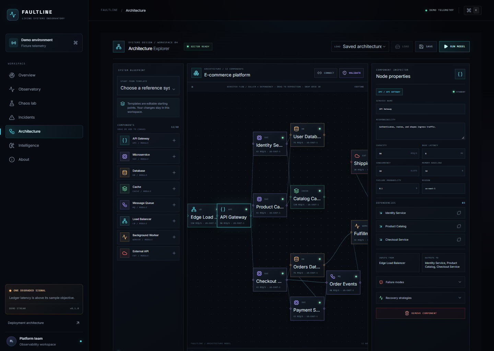
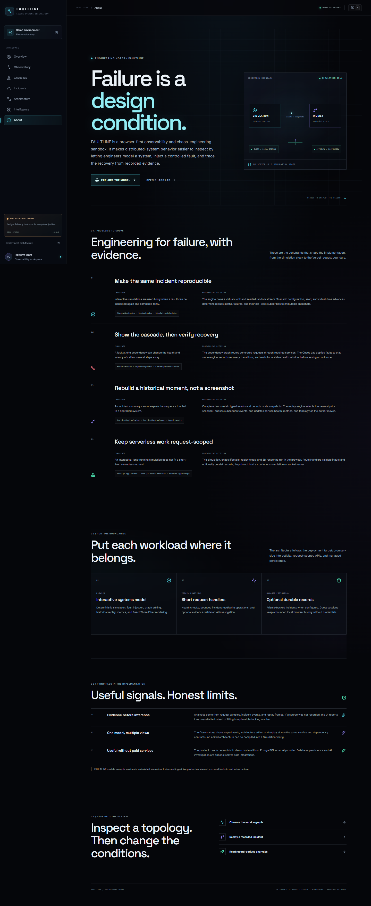
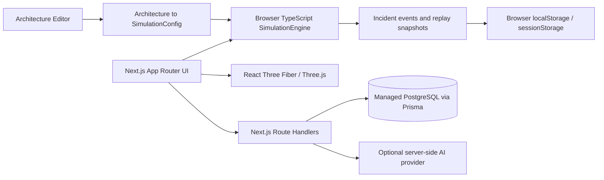

# FAULTLINE — The Living Systems Observatory

FAULTLINE is an interactive engineering sandbox for exploring distributed-system behavior. Build a service graph, inject a controlled failure into a deterministic browser simulation, inspect the cascade, verify recovery, and replay the recorded incident.

It is a model and learning environment. It does **not** ingest production telemetry, connect to real infrastructure, or send faults to external services.

## Live demo

**Deployment URL:** _pending a verified Vercel deployment_

Replace this line with a real `vercel.app` or custom-domain URL only after the deployed routes and required integrations have been checked. No deployment is claimed by this repository state.

## Screenshots

Screenshots show the current demo interface. They do not represent production telemetry or a connected customer environment.

### Landing experience



### Interactive observatory



### Chaos Engineering Laboratory



### Architecture Explorer



### Engineering showcase



## Features

- **Landing:** cinematic, responsive interface with a browser-rendered network scene.
- **Observatory:** interactive 3D service topology, service inspector, animated request paths, and browser-side system controls.
- **Chaos Lab:** configurable database, API, network, cache, queue, authentication, termination, and cascading failure scenarios; bounded recovery verification.
- **Incident archive:** event timeline, historical service state, and deterministic replay with seeking and playback controls.
- **Architecture Explorer:** editable service graphs, templates, connection validation, browser-local saves, and simulation from the edited graph.
- **Intelligence:** metrics and reports calculated from recorded request samples, events, and snapshots. Missing evidence stays unavailable instead of being fabricated.
- **Optional Incident Investigator:** server-side AI integration with input/output validation and an explicitly labeled deterministic fallback when AI is not configured or unavailable.
- **Demo mode:** core workflows run without paid services or database credentials. Guest incident history and architecture documents are stored in the browser.

## Routes

| Route           | Purpose                                             |
| --------------- | --------------------------------------------------- |
| `/`             | Landing page and product introduction               |
| `/observatory`  | Interactive service topology and metrics            |
| `/chaos-lab`    | Failure configuration, execution, and recovery      |
| `/incidents`    | Saved incidents, replay, and optional investigation |
| `/architecture` | Visual system editor and model runner               |
| `/intelligence` | Record-derived analytics and PDF/CSV export         |
| `/about`        | Engineering challenges and implementation decisions |

## Architecture



- Pages and shared layouts use the Next.js App Router. Route composition is server rendered; interactive surfaces use client components where browser state, animation, canvas, or event subscriptions are required.
- The simulation, chaos lifecycle, and incident replay are browser-side TypeScript. Serverless functions do not host a simulation loop or WebSocket server.
- React Three Fiber renders the 3D topology in the browser. Canvas modules are dynamically loaded where needed so Three.js is not evaluated during server rendering.
- Route Handlers use the Node.js runtime for request validation, optional persistence, health checks, and the optional AI request.
- Prisma 7 and `@prisma/adapter-pg` provide managed PostgreSQL access. Browser-local persistence keeps demo mode useful without database credentials.
- There is no custom long-running Node.js server, filesystem persistence, or in-process cross-request state contract.

For component responsibilities, state flows, storage boundaries, security assumptions, and failure cases, see [ARCHITECTURE.md](ARCHITECTURE.md).

## Tech stack

- Next.js 16 App Router, React 19, strict TypeScript
- Tailwind CSS 4 and CSS Modules
- Motion and GSAP/ScrollTrigger
- Three.js, React Three Fiber, and Drei
- Browser-side deterministic simulation engine
- Prisma 7 with PostgreSQL adapter (`pg`)
- Vitest, Playwright, and axe-core
- Vercel for the intended web and function deployment target

## Simulation engine

`simulation/SimulationEngine` is independent of React and Three.js. It owns the simulation clock, seeded random generator, task scheduler, service registry, dependency graph, request routing, traffic generation, and metrics aggregation.

The same simulation configuration, seed, and virtual-time advances produce reproducible results. Tests use `advanceBy()` and `runTicks()` to move virtual time deterministically. Interactive browser sessions use `start()` and `pause()` as a wall-clock adapter over that same virtual clock. React views subscribe to immutable snapshots; they do not generate metrics or random values themselves.

The Chaos Lab applies scenario configuration to the engine. Failure and recovery transitions, request outcomes, samples, and replay frames form an incident record when recovery verification completes. The replay engine reconstructs a point in time by loading the nearest preceding snapshot and applying later typed events.

More detail and a model-flow diagram are in [simulation/README.md](simulation/README.md).

## Database design

The managed PostgreSQL schema is in `prisma/schema.prisma`; versioned PostgreSQL migrations are in `prisma/migrations/`.

### `Incident`

Stores the incident ID, name, timestamps, severity, affected services, root cause, failure configuration, recovery actions, outcome, metrics, simulation start/end time, typed events, replay frames, and sampled request latencies. Database indexes support recent-incident and severity/time queries.

### `ChaosExperiment`

Defines a persisted experiment record shape for future managed experiment workflows. The current Chaos Lab executes in the browser and does not save its configuration to this table.

### Persistence modes

- With no `DATABASE_URL`, records use bounded guest browser storage: up to eight incidents and approximately 3.2 MB. `sessionStorage` is attempted if `localStorage` is blocked; an in-memory current-page fallback is used if both are unavailable.
- Architecture documents are saved locally in the browser, with a bounded collection. They are not currently written to PostgreSQL.
- With `DATABASE_URL`, incident Route Handlers use Prisma. Browser-local records remain the fallback if the database cannot be reached.
- Actual managed-database connectivity and migrations must be verified against the target database before enabling persistent production use.

## API

All server endpoints are Next.js Route Handlers and use request-scoped work. They do not run simulations.

| Method and path              | Behavior                                                                                                                                                                                    |
| ---------------------------- | ------------------------------------------------------------------------------------------------------------------------------------------------------------------------------------------- |
| `GET /api/health`            | Returns application status and demo/unconfigured/connected/degraded database status.                                                                                                        |
| `GET /api/observatory`       | Returns the no-store example observability snapshot.                                                                                                                                        |
| `GET /api/incidents`         | Returns recent database incident summaries, or an empty demo result when database persistence is not configured. The browser merges this with local guest history.                          |
| `GET /api/incidents?id={id}` | Returns a stored incident with events and replay frames.                                                                                                                                    |
| `POST /api/incidents`        | Validates same-origin JSON, enforces a 1.6 MB body limit, validates the incident schema, then creates the record when PostgreSQL is configured. Duplicate IDs are handled idempotently.     |
| `POST /api/investigations`   | Validates and bounds incident evidence, optionally calls the AI provider from the server, validates its structured result, and otherwise returns an explicit unavailable/fallback response. |

Incident and investigation endpoints currently do not provide user authentication or account-based quotas. Same-origin checks are not authentication. Keep a database-enabled deployment behind appropriate access controls until application authentication and distributed request limits exist. Do not enable a billable AI key on an unprotected public deployment.

## Installation

Requirements: Node.js 20.19 or newer and npm.

```sh
npm ci
npm run dev
```

Open the local development URL printed by Next.js. The core interface works without `.env` configuration. No paid service is required for the deterministic simulation, editor, guest incident history, or client-side reports.

To use local managed PostgreSQL or AI, copy `.env.example` to `.env.local` and fill only the variables you intend to use. Keep real credentials out of source control.

## Environment variables

| Variable             | Required                                  | Used by                    | Notes                                                                                                                |
| -------------------- | ----------------------------------------- | -------------------------- | -------------------------------------------------------------------------------------------------------------------- |
| `DATABASE_URL`       | No for demo; yes for database persistence | Server runtime and Prisma  | Use the provider's pooled/serverless PostgreSQL connection. Keep server-only; never use a `NEXT_PUBLIC_` prefix.     |
| `DIRECT_URL`         | Required to run database migrations       | Prisma CLI/configuration   | Use the provider's direct or migration connection. Prefer a trusted migration job rather than the application build. |
| `OPENAI_API_KEY`     | No                                        | `/api/investigations` only | Optional server-only secret. Leave unset to use the deterministic local fallback. Never expose it to client bundles. |
| `FAULTLINE_AI_MODEL` | No                                        | `/api/investigations` only | Optional server-side model override. Defaults to the value in the Route Handler.                                     |

`.env.example` contains empty values and no working credentials. Vercel environment variables must be configured separately for Development, Preview, and Production as required. A variable change applies to new deployments, not an already-built deployment.

## Database setup and migrations

1. Create a managed PostgreSQL database in a provider region appropriate for the Vercel Function region.
2. Configure `DATABASE_URL` with the provider's pooled connection and `DIRECT_URL` with a migration-capable connection.
3. In a trusted environment where `DIRECT_URL` is available, install locked dependencies and apply committed migrations:

   ```sh
   npm ci
   npm run db:migrate
   ```

4. Deploy a new build and verify `GET /api/health` reports `database: "connected"`.
5. Verify incident creation and read-back using a non-production database before routing production traffic.

Never run production migrations automatically as part of a Vercel Function request. Coordinate schema rollout with the deployed application version. If `DATABASE_URL` is absent, the application remains in demo mode. If the database is configured but unavailable, database-backed requests report failure while local guest history remains available.

## Testing and quality checks

```sh
npm run lint
npm run format:check
npx tsc --noEmit
npm test
npm run build
npx playwright install chromium   # one-time browser setup
npm run test:e2e
```

The Vitest suite covers deterministic simulation, traffic and failures, dependency propagation, recovery policies, incident validation/persistence fallbacks, replay reconstruction, architecture validation, analytics, and report generation. Playwright runs against a production build and checks page routes, the 3D canvas, simulation and recovery workflows, incident recording/replay, architecture editing, report export, route accessibility, responsive overflow, and browser load smoke metrics.

Database-backed integration requires a reachable managed PostgreSQL database. Tests run in demo/local mode unless test database credentials are intentionally supplied. The browser smoke numbers are local measurements and are not field Core Web Vitals or a guarantee of deployed-device performance.

## GitHub and Vercel deployment

This project is a native Next.js App Router application. Vercel detects Next.js and provides the standard build/output behavior; no custom Node.js server, `vercel.json` rewrite layer, WebSocket server, or persistent function process is required.

### Connect GitHub

1. Push the repository to GitHub.
2. In Vercel, choose **Add New → Project**, import the repository, and confirm the repository root is the project root.
3. Confirm the framework is detected as **Next.js**. Use `npm ci` as the install command and `npm run build` as the build command. Keep the Next.js output setting at its platform default.
4. Select the production branch. Git-connected non-production branch pushes and pull requests create Preview deployments; changes to the configured production branch create Production deployments.
5. Keep Preview and Production environment variables scoped to their intended environment. Use separate databases where available.

### Configure the Vercel project

- Add `DATABASE_URL` only when enabling managed incident persistence. Add `DIRECT_URL` for the trusted migration workflow. Add `OPENAI_API_KEY` only when enabling provider analysis. `FAULTLINE_AI_MODEL` is optional.
- Do not prefix secrets with `NEXT_PUBLIC_`; client-prefixed Next.js variables are embedded for browser use.
- Use the Node.js runtime for Route Handlers. The health, incident, and investigation handlers specify or use Node-compatible runtime behavior.
- Keep the application in demo mode or enable Vercel deployment access controls until authentication and distributed rate limits protect public database writes and optional paid AI usage.
- Check the function's region against the managed database region to avoid unnecessary connection latency.
- After changing environment values, create a new deployment so the build and Functions receive them.

### Release verification

For a Preview deployment, verify each route in the route table, `/api/health`, `/api/observatory`, incident input validation, the AI unavailable fallback, the 3D canvas in a real browser, mobile layout, and a complete simulation → recovery → incident → replay workflow. With a configured database, verify connected health and create/read an incident using a non-production database before promoting the release. Promote or deploy to Production only after the checks match the configured environment. Do not treat a successful local build as proof of a successful deployment.

Vercel documentation: [GitHub deployments](https://vercel.com/docs/git/vercel-for-github), [deployment environments](https://vercel.com/docs/deployments/environments), [environment variables](https://vercel.com/docs/environment-variables), [builds](https://vercel.com/docs/builds), and [Node.js Function runtime](https://vercel.com/docs/functions/runtimes).

## Security and current scope

- Secrets are read only from server environment variables in Route Handlers or the Prisma client. No database or AI keys are intentionally exposed to client code.
- Incident writes and AI requests validate same-origin browser requests and bound payload sizes. These checks reduce accidental and malformed input; they do not replace authentication, authorization, or distributed rate limiting.
- User-entered scenario names and architecture labels are rendered as ordinary React text. The application does not use raw HTML injection for user content.
- Realtime multi-user collaboration, production telemetry ingestion, authentication/teams, distributed quotas, and policy-gated real infrastructure experiments are outside the current implementation.
- No production URL, connected production database, customer usage, or real infrastructure deployment is asserted by this repository.
